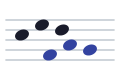

# Contrapunto alla mente

Contrapunto alla mente is a trainer for improvising counterpoint, the "counterpoint in the mind" that singers and organists once made up on the spot. It isn't a generator: it shows the rules so they can be learned and checked, with fast drills for recall and a workbench for slower, worked-out exercises. Every page draws its notation and plays it back in the browser, from one rules core that is tested against the published charts.

It starts with Sergei Taneyev's vertical-shifting counterpoint, the method of his *Convertible Counterpoint in the Strict Style*, and the canon, toward a near-term goal: a two-voice canon over a hymn-tune cantus firmus. Other methods (partimento, schemata, figured bass) can join it later as sections of their own. **[▶ Open the site](https://choyun1.github.io/contrapunto-alla-mente/)**: it runs in the browser, with nothing to install.

<!-- Contents: one entry per ## section, in order. -->
<table><tr><td>

<small><b>Contents</b><br>
1&ensp;Using it<br>
&emsp;1.1&ensp;[What it's for](#what-its-for)<br>
&emsp;1.2&ensp;[Conventions](#conventions)<br>
2&ensp;The code<br>
&emsp;2.1&ensp;[Layout](#layout)<br>
&emsp;2.2&ensp;[Working on it](#working-on-it)<br>
3&ensp;The project<br>
&emsp;3.1&ensp;[Roadmap](#roadmap)<br>
&emsp;3.2&ensp;[Sources, credits and license](#sources-credits-and-license)</small>

</td></tr></table>

## What it's for

- **Taneyev consonance charts.** Pick a vertical shift (J<sub>v</sub>) and see what every interval of the original becomes, with Taneyev's suspension marks and which consonances stay free, which turn perfect and which become dissonant. Each chart shows n = m + J<sub>v</sub>, the interval strip on a staff and a Play button, and the charts are ordered by family: 0, the octave, the 12th and 10th, their reductions, the direct shifts and the rare ones.
- **Three-voice shifts.** Enter the outer voices' J<sub>v</sub> and see every way a middle voice can split it, since J<sub>v</sub>(upper, lower) = J<sub>v</sub>(upper, middle) + J<sub>v</sub>(middle, lower), with all three pair charts. Splits where both inner pairs land on an easy shift (0, −7, −9 or −11) are marked, because the hardest pair rules the texture.
- **Canon proposta intervals.** In a two-voice canon every melodic interval the proposta makes across the delay becomes a harmonic interval between the voices. Pick an interval of entrance to see which melodic intervals stay consonant, and paste a proposta in pitch names to have every pairing checked.

Coming next is a **canon workbench**, for writing a canon over a hymn-tune cantus firmus and checking each pairing as you go. See the [Roadmap](#roadmap).

## Conventions

Intervals are zero-indexed, as Taneyev numbers them: unison 0, 2nd 1, 3rd 2, 5th 4, octave 7, 10th 9, 12th 11. The derivative of interval m at index J<sub>v</sub> is n = m + J<sub>v</sub>. A negative interval means the voices have crossed. The 4th counts as a dissonance, as in two-voice writing.

## Layout

| Path | What it holds |
| --- | --- |
| `src/taneyev/rules.js` | The rules core for Taneyev's vertical-shifting counterpoint. Every page and checker uses it. |
| `src/taneyev/three-voices.js` | Splits an outer shift between the two inner pairs of a three-voice texture. |
| `src/taneyev/canon.js` | The canon rules: which proposta intervals stay consonant at an interval of entrance, and the proposta checker. |
| `src/taneyev/examples.js` | Builds the generated examples (interval strips, parallel chains) from the rules core. |
| `src/notation/`, `src/common/diatonic.js` | Turn diatonic pitches into abc notation, which the pages draw and play with [abcjs](https://www.abcjs.net/) (loaded from a CDN, pinned to 6.4.4). |
| `taneyev/` | The consonance charts page and the three-voice shifts page. `chart-card.js` draws one chart card for both. |
| `canon/` | The canon proposta page. |
| `scores/` | LilyPond sources for fixed music examples. CI compiles each `.ly` file to SVG under `scores/` on the site. |
| `assets/` | Shared styles (`site.css`), the logo (`logo.svg`, a short canon in noteheads), the same canon on a staff for large sizes (`logo-staff.svg`), and the browser-tab icon (`favicon.svg`). |
| `test/` | Tests for the rules core, including the charts from *Movable Counterpoint* video 2. |

## Working on it

```sh
npm test        # run the rules tests (Node 22, no dependencies)
npm run serve   # serve the site at http://localhost:8000
```

There is no build step: the pages are plain ES modules that run as they are in the browser and in Node. Live notation uses abcjs; LilyPond is only for the fixed examples, because it can't run in a browser. Each push to `main` runs the tests and publishes the site to GitHub Pages.

See [CLAUDE.md](CLAUDE.md) for the code organization and style rules.

## Roadmap

- **Canon workbench.** Write a canon over a hymn-tune cantus firmus and check every pairing as you go.
- **Tune screening.** Rank a tune's canon intervals and time distances by how hard their indices are, to find hymn tunes that take a canon well.
- **Drills.** Timed recall of each index, then play-along practice with live feedback.

## Sources, credits and license

The rules follow Taneyev, *Convertible Counterpoint in the Strict Style* (§§81–82, 90, 101, 128, 135), and Christopher Segall, ["Sergei Taneev's Vertical-Shifting Counterpoint: An Introduction"](https://mtosmt.org/issues/mto.14.20.3/mto.14.20.3.segall.php), *Music Theory Online* 20.3 (2014), with charts checked against the *Movable Counterpoint* video course. Each rule in the code cites its section. Notation and playback are by [abcjs](https://www.abcjs.net/) (MIT); the GitHub mark in the footer is from Primer Octicons (MIT).

It was built by Adrian Cho with Claude (Anthropic) in 2026. The code is under the MIT License ([LICENSE](LICENSE)).
